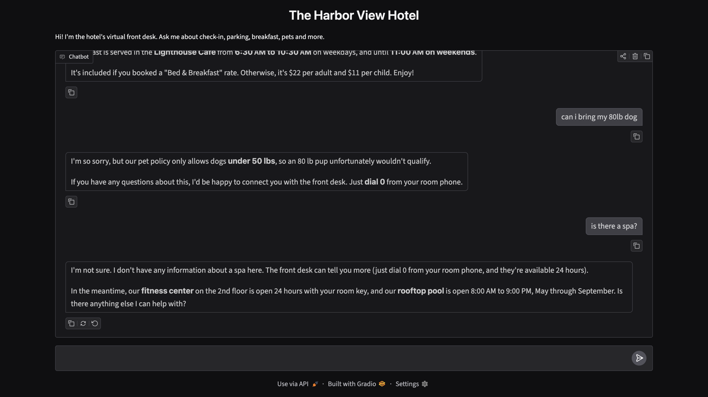

# Hotel Guest FAQ Bot

A virtual front desk assistant that answers hotel guests' questions — check-in times, parking, breakfast, pet policy, and more — using Claude.

**[Try it live →](https://hotel-faq-bot.onrender.com)** *(hosted on a free server that sleeps when idle, so the first visit can take about a minute to wake up)*



I spent years in hospitality, where the same handful of guest questions come up all day. This project is my first step in applying AI to that problem: a bot that answers from the hotel's own information, and hands off to a human when it doesn't know.

## How it works

- The `hotels` folder holds one plain-text file per hotel, with the hotel's name on the first line. There are three fictional hotels: a waterfront hotel, a mountain lodge, and a city boutique hotel. **To add a hotel, just drop in a new `.txt` file**; no code changes needed.
- Guests pick their hotel from a dropdown. Switching hotels starts a fresh conversation, so details from one hotel never leak into another.
- `faq_bot.py` sends the guest's question to Claude along with a **system prompt** containing that hotel's info and a few rules:
  - Answer only from the hotel information.
  - If the answer isn't there, say so and offer to connect the guest with the front desk. **Never make up details.**
  - Keep answers short and warm, like a good front desk agent.
- `app.py` puts a chat web page in front of the bot using [Gradio](https://www.gradio.app/).
- **Conversation memory:** Claude doesn't remember anything between requests, so the bot sends the whole conversation each time. That's what lets a guest ask "Is there parking?" and then "How much is it?"

The "don't make things up" rule matters most. A bot that confidently invents a pool or a spa is worse than no bot at all, so a good test is asking about something the hotel doesn't have.

## Example

The Harbor View Hotel allows dogs under 50 lbs and has no spa. Here's how the bot handled both:

> **Guest:** can i bring my 80lb dog
> **Bot:** I'm so sorry, but our pet policy only allows dogs **under 50 lbs**, so an 80 lb pup unfortunately wouldn't qualify. If you have any questions about this, I'd be happy to connect you with the front desk. Just **dial 0** from your room phone.

> **Guest:** is there a spa?
> **Bot:** I'm not sure. I don't have any information about a spa here. The front desk can tell you more (just dial 0 from your room phone, and they're available 24 hours). In the meantime, our **fitness center** on the 2nd floor is open 24 hours with your room key, and our **rooftop pool** is open 8:00 AM to 9:00 PM, May through September. Is there anything else I can help with?

It applied the pet policy correctly, and instead of inventing a spa it handed off to the front desk and suggested amenities the hotel actually has.

## Running it yourself

You'll need Python 3 and an [Anthropic API key](https://console.anthropic.com).

```bash
git clone https://github.com/stevdesch-collab/hotel-faq-bot.git
cd hotel-faq-bot
python3 -m venv .venv
.venv/bin/pip install -r requirements.txt
export ANTHROPIC_API_KEY="your-key-here"
```

Then start the web page and open http://localhost:7860:

```bash
.venv/bin/python app.py
```

Or chat in the terminal:

```bash
.venv/bin/python faq_bot.py
```

## What I'd add next

- An automatic test set: a list of guest questions with the answers each hotel should give, checked every time the prompt changes.

## Built with

Python · [Anthropic Claude API](https://docs.anthropic.com) · [Gradio](https://www.gradio.app/) · Hosted on [Render](https://render.com)

Built after completing *Python for Everybody* (University of Michigan, Coursera) and *ChatGPT Prompt Engineering for Developers* (DeepLearning.AI).
