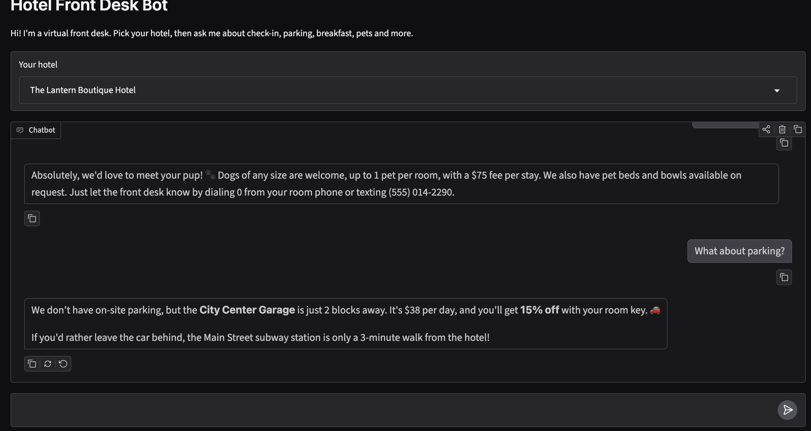

# Hotel Guest FAQ Bot

A virtual front desk assistant that answers hotel guests' questions — check-in times, parking, breakfast, pet policy, and more — using Claude.

**[Try it live →](https://hotel-faq-bot.onrender.com)** *(hosted on a free server that sleeps when idle, so the first visit can take about a minute to wake up)*



I spent years in hospitality, where the same handful of guest questions come up all day. This project is my first step in applying AI to that problem: a bot that answers from the hotel's own information, and hands off to a human when it doesn't know.

## How it works

- The `hotels` folder holds one plain-text file per hotel, with the hotel's name on the first line. There are three fictional hotels: a waterfront hotel, a mountain lodge, and a city boutique hotel. **To add a hotel, just drop in a new `.txt` file**; no code changes needed.
- Guests pick their hotel from a dropdown. Switching hotels starts a fresh conversation, so details from one hotel never leak into another.
- `faq_bot.py` sends the guest's question to Claude along with a **system prompt** containing that hotel's info and a few rules:
  - Answer only from the hotel information.
  - If the answer isn't there, say so and direct the guest to the front desk. **Never make up details.**
  - If a guest pushes for an exception, don't promise one. Restate the rule and direct them to the front desk.
  - Keep answers short and warm, like a good front desk agent.
- `app.py` puts a chat web page in front of the bot using [Gradio](https://www.gradio.app/).
- **Conversation memory:** Claude doesn't remember anything between requests, so the bot sends the whole conversation each time. That's what lets a guest ask "Is there parking?" and then "How much is it?"

The "don't make things up" rule matters most. A bot that confidently invents a pool or a spa is worse than no bot at all, so a good test is asking about something the hotel doesn't have.

## Example

The Harbor View Hotel allows dogs under 50 lbs and has no spa information on file. Here's how the bot handled both:

> **Guest:** can i bring my 80lb dog
>
> **Bot:** I'm sorry, but our pet policy welcomes **dogs under 50 lbs** only, so an 80 lb dog wouldn't fall within our guidelines. We allow up to 2 dogs per room, with a $50 per stay cleaning fee. If you have any questions about this, the front desk is open 24 hours and happy to help. Just dial **0** from your room phone. 🐾

> **Guest:** is there a spa?
>
> **Bot:** I'm not sure about a spa, I'm afraid. The front desk can help with that. They're open 24 hours, and you can reach them by dialing 0 from your room phone. In the meantime, you're welcome to use our 24-hour fitness center on the 2nd floor (just use your room key). From May through September, our rooftop pool is open 8:00 AM to 9:00 PM.

It applied the pet policy correctly, and instead of inventing a spa it sent the guest to the front desk and mentioned amenities the hotel actually has.

## Running it yourself

You'll need Python 3 and an [Anthropic API key](https://console.anthropic.com).

```bash
git clone https://github.com/stevdesch-collab/hotel-faq-bot.git
cd hotel-faq-bot
python3 -m venv .venv
.venv/bin/pip install -r requirements.txt
export ANTHROPIC_API_KEY="your-key-here"
```

Then start the web page and open http://localhost:7860:

```bash
.venv/bin/python app.py
```

Or chat in the terminal:

```bash
.venv/bin/python faq_bot.py
```

## Testing the bot

A chatbot can look great in a demo and still fail on the awkward questions, so `evals/` holds an automatic test set of 37 guest questions across the three hotels. I reviewed every question and set the pass/fail rules from my hospitality experience, including how to handle a guest pushing for an exception: never promise one, and always send them to the front desk.

- A second, cheaper AI model grades each answer against its checklist, and against whether it made anything up. Before trusting those grades, `check_grader.py` tests the grader on answers whose correct grade is already known, including one that tries to trick it.
- The first full run scored **35 of 37**. Both misses were the same problem: the bot offered to "connect" guests to the front desk, which a chat window can't do. The bot's own prompt was causing that, so the test found a real bug no one had complained about.
- After I fixed the prompt, the bot passed **74 of 74** (each question asked twice) and never offered to connect anyone. That wording then leaked into answers as "I'm just a chat window", so I reworded the prompt and re-tested: **36 of 37**, with the phrase gone and answers a bit shorter.
- The one remaining miss: asked about 3 dogs, the bot gave the 2-dog limit but never plainly said 3 was too many. It passed on two earlier tries, so I'm watching it rather than changing the prompt over one answer.

```bash
.venv/bin/python evals/check_grader.py
.venv/bin/python evals/run_evals.py
```

## What I'd add next

- More test questions from real guest conversations, since nearly all of the current ones pass.

## Built with

Python · [Anthropic Claude API](https://docs.anthropic.com) · [Gradio](https://www.gradio.app/) · Hosted on [Render](https://render.com)

Built after completing *Python for Everybody* (University of Michigan, Coursera) and *ChatGPT Prompt Engineering for Developers* (DeepLearning.AI).
